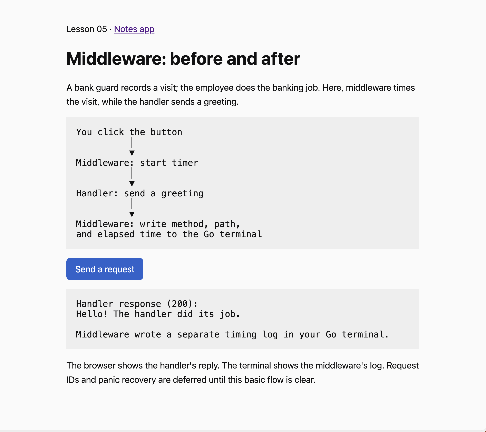

# Lesson 05: Middleware

Current implementation: logging only. Request IDs and recovery are follow-ups, not active features.

## Browser demonstration



The browser displays the handler's response. Middleware separately writes timing information into the Go terminal. The diagram explains the sequence; it is not a live execution trace.

## Files and responsibilities

| File | Responsibility |
| --- | --- |
| middleware.go | Start a timer, call the next handler, then log method/path/duration |
| demo.go | Register the page route and the greeting handler |
| index.html | Display the button, send the request, and show the response |
| middleware_test.go | Verify logging, unchanged responses, and omission of private query values |

There is no requirement to name a file handler.go. The demonstration handlers live in demo.go. Go discovers test files by the _test.go suffix; middleware_test.go is named for the behavior being tested.

```text
You click “Send a request”
             │
             ▼
Browser JavaScript sends GET /api/middleware/success
             │
             ▼
Logging middleware starts the timer
             │
             ▼
Router selects the greeting handler
Handler writes “Hello! The handler did its job.”
             │
             ▼
Logging middleware records method, path, duration
             │
             ▼
Browser shows the greeting; terminal shows the log
```

The page HTML is embedded when Go builds the program, so HTML changes require restarting Go and reloading the page. The logger does not alter the response or grant access. Route registration means mapping URLs/methods to handlers; it is distinct from logging visitor activity.

## Handler: the person doing the job

When I click Save note, the browser sends POST /api/notes with the note text. The Create handler reads and validates the text, asks PostgreSQL to save it, and writes the HTTP response. A handler is code responsible for answering a request.

## Router: choosing the right person

The router looks at the method and URL to choose a handler. POST /api/notes goes to Create; DELETE /api/notes/2 goes to Delete. It selects the job, rather than doing the database work itself.

## Middleware: a bank's security guard

Imagine a bank with employees who open accounts, handle withdrawals, and change customer details. Each employee does a different job, but visitors pass the same security desk. The guard checks identification, records arrival time, and allows or refuses entry. The guard does not do the banking work.

The visitor is the incoming request. The bank employee is the handler. Middleware is the shared security-desk process around the handler.

For example, authentication middleware could check sign-in before deletion. This is an illustration, not authentication already implemented in this app:

```text
You click “Delete note #2”
             │
             ▼
Authentication middleware
“Is this person signed in?”
             │
       ┌─────┴─────┐
       │           │
      NO          YES
       │           │
       ▼           ▼
Return 401     Delete handler runs
“Sign in”      and removes note #2
                   │
                   ▼
               Return 204
               “Deleted”
```

Authentication checks identity. Authorization is a separate question: is this signed-in person allowed to delete this particular note? Sign-in alone is not sufficient for a production app.

Without middleware, each protected handler would repeat the sign-in check. Middleware lets one shared check protect several handlers. It can stop a request instead of calling the next handler.

## Logging: the guard's visitor register

Logging middleware observes requests instead of deciding permissions. It starts a timer, lets the handler do its job, then records the result.

```text
Request arrives
      │
      ▼
Logging middleware:
“Start timing this request.”
      │
      ▼
Create handler:
“Save the note in PostgreSQL.”
      │
      ▼
Logging middleware:
“The handler finished.
Record its method, path, and how long it took.”
```

Example log, not a measured result:

```text
method="POST" path="/api/notes" duration=80ms
```

This means a request to create a note finished its handler call in 80 milliseconds. This simple logger does not record success/failure or response status. It is server-side handling time, not necessarily the user's total browser/network wait. Do not log database passwords, authorization tokens, or private request bodies.

Middleware is a reusable step placed around the code doing the actual job. It can check something before the job, observe the result afterward, or stop the request entirely.

## Try the simplest implementation

1. Restart Go with `go run ./14-backend-labs/cmd/server`.
2. Reload http://127.0.0.1:8080/concepts/middleware.
3. Click Send a request. The browser shows a greeting from the handler.
4. Look in the Go terminal: middleware logs method, path, and elapsed time.

The middleware core has three steps: start timer, call the next handler, log elapsed time. No response wrapper, custom context, request ID, or panic recovery is required for this first example. Logging happens after a normal handler return; this minimal version does not produce completion logs when a panic interrupts the call. Go HTTP server behavior still applies, but there is no custom JSON recovery response. No note data or database setup changes.

Tests confirm the handler runs, the response stays unchanged, and the completion log excludes query parameters. Run `go test -v ./14-backend-labs/concepts/05-middleware`. Browser verification remains a separate manual step.

Request IDs, response-status logging, and panic recovery can be added one at a time after this flow is clear.
