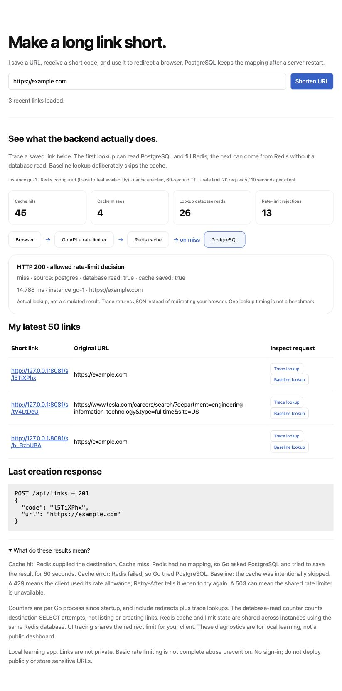
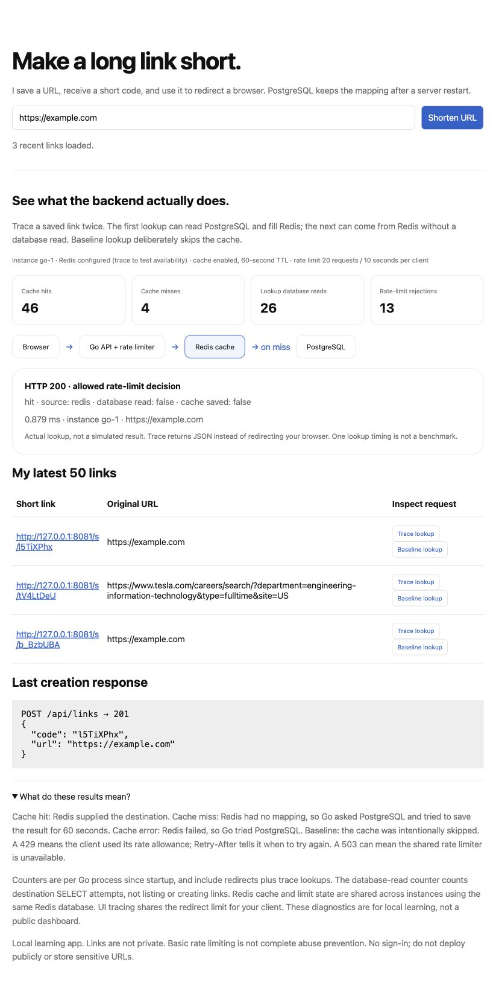

# URL shortener: my working architecture

## Current UI: real cache lookups

I ran this locally with Go, PostgreSQL on Neon, and Redis in Docker Desktop. These screenshots show actual requests, not simulated results. The counters include earlier experiments in the same Go process.

### First lookup: PostgreSQL fills the cache

Redis has no cached mapping, so Go reads PostgreSQL and saves the destination in Redis with a 60-second TTL.



### Repeat lookup: Redis answers

The next request for the same code hits Redis without another destination lookup in PostgreSQL. The displayed timings are individual observations, not a load-test benchmark or a guaranteed speedup.



For current setup, implementation details, and experiments, I use the [backend lab guide](BACKEND_LAB.md). The architecture notes below document my initial database-only version and the reasoning that led to this upgrade.

I am building one small Go project to connect backend concepts to a real feature. My experiments and gradual concept learning remain in 14-backend-labs; this project lives separately in 15-url-shortener. I focus on request flow, data, file responsibilities, and design tradeoffs rather than memorizing every library call.

## What I built first

I can create a short code, list my latest 50 links in a browser, and open a short link to redirect to the original URL. PostgreSQL persists the mappings. This is local-only and unauthenticated, not ready for public deployment.

The examples below are illustrative, not claims about data already in my database. The code generates eight URL-safe random characters. Example: aB3kP9xQ.

## Creating a link: actual example at each step

```text
       O
      /|\   USER: me
      / \
       |
       v
+----------------------------------------------+
| BROWSER UI: http://127.0.0.1:8081            |
| Input URL:                                   |
| https://example.com/articles/how-to-learn-go |
| [ Shorten URL ]                              |
+----------------------------------------------+
       |
       | POST /api/links
       v
+---------------------------------------------+
| GO SERVER                                   |
| Validate: HTTP(S), hostname, no credentials |
| Generate example code: aB3kP9xQ             |
+---------------------------------------------+
       |
       | INSERT code + original URL
       v
+---------------------------------------------+
| POSTGRESQL ON NEON                          |
| Table: url_shortener.links                  |
| Durable storage: rows survive Go restarting |
+---------------------------------------------+

Example saved rows (URL shown in full):
+-----------+----------------------------------------------+------------------+
| code (PK) | original_url                                 | created_at (UTC) |
+-----------+----------------------------------------------+------------------+
| aB3kP9xQ  | https://example.com/articles/how-to-learn-go | 2026-10-16 12:00 |
| Z7mN2rLs  | https://example.org/docs                     | 2026-10-16 12:01 |
+-----------+----------------------------------------------+------------------+
Go returns status 201 and:
{
  "code": "aB3kP9xQ",
  "url": "https://example.com/articles/how-to-learn-go"
}

Browser builds the short link:
http://127.0.0.1:8081/s/aB3kP9xQ
```

PK means primary key: PostgreSQL rejects duplicate codes and creates a unique index. My timestamps above are example values; PostgreSQL supplies real timestamps using now(). Validation checks URL structure and permitted scheme, not whether the destination exists or is trustworthy. My server does not fetch the target page.

The code is a lookup key, not a compressed or encrypted copy of the original URL. Six random bytes encode as eight URL-safe characters, giving 48 bits of randomness. Randomness reduces collisions but never replaces the database uniqueness constraint. On conflict, I generate another code, with at most five attempts. A short link is not a secret or an access-control mechanism. Submitting the same URL twice creates independent links in this version.

## Opening a short link: redirect is a second browser request

```text
       O
      /|\   VISITOR opens the short link
      / \
       | GET /s/aB3kP9xQ
       v
+------------------------------------------+
| GO SERVER                                |
| Read code: aB3kP9xQ                      |
| Query PostgreSQL using a SQL parameter:  |
| SELECT original_url                      |
| FROM url_shortener.links WHERE code = $1 |
+------------------------------------------+
       |
       v
+---------------------------------------------------------+
| POSTGRESQL: primary-key lookup                          |
| code     | original_url                                 |
| aB3kP9xQ | https://example.com/articles/how-to-learn-go |
+---------------------------------------------------------+
       |
       v
Is the mapping found?
       |
       +-- NO --> Return 404 (Not Found)
       |
       +-- YES --> Return 302 with Location header
                       |
                       v
+----------------------------------------------+
| VISITOR'S BROWSER                            |
| Location:                                    |
| https://example.com/articles/how-to-learn-go |
| Send a NEW request to that destination.      |
+----------------------------------------------+
       |
       v
+-----------------------------------------+
| DESTINATION WEB SERVER: example.com     |
| Returns its own webpage to the visitor. |
+-----------------------------------------+

Go performs the lookup; it does not fetch the destination page.
```

I use 302 and no-store for this learning version so repeat clicks continue exercising the lookup. A permanently cacheable redirect can bypass future backend lookups and affect analytics or destination changes. Redirect choice depends on product requirements, not on one universally best status.

My localhost short links work only on my own computer. A visitor on another computer needs a deployed service with a reachable domain; I have not deployed one.

## Files: where each responsibility lives

| File | Responsibility |
| --- | --- |
| main.go | Read private database configuration, connect, start on localhost:8081, drain requests on shutdown |
| handler.go | Register routes, validate input, allocate codes, execute parameterized SQL, return JSON or redirects |
| schema.sql | Create a separate namespace/table without modifying my existing notes |
| index.html | Browser form, latest links table, and real API result display |
| handler_test.go | URL validation, simulated collision retry, redirect/missing/database errors, and invalid input |

I reuse the repository's Go module and PostgreSQL driver. I do not introduce layers or infrastructure just to make the folder bigger.

## Setup

1. In my existing Neon project's SQL Editor, on the same database/branch I use for notes, I run schema.sql from this folder. It creates url_shortener.links, not backend_labs.notes. It does not delete existing data. Re-running CREATE IF NOT EXISTS does not migrate an existing table to a different definition.
2. In a terminal where DATABASE_URL is already exported, I run:

   ```sh
   go run ./15-url-shortener
   ```

   For a new zsh terminal I enter the URI privately first:

   ```sh
   read -rs 'DATABASE_URL?Paste database connection URI (hidden): '; echo
   export DATABASE_URL
   ```

   I retain Neon's TLS settings and never paste credentials into chat, screenshots, or source files. The application does not automatically load .env.
3. I open http://127.0.0.1:8081, submit an HTTPS URL, and click the returned short link. My browser should open the destination in a new tab.
4. I restart Go and confirm the link remains listed and works.
5. I can inspect saved rows in Neon with SELECT code, original_url, created_at FROM url_shortener.links;.

The UI has no curl requirement. HTML is embedded, so I restart Go after changing it. The lab server on port 8080 may remain running separately.

## Working first, optimizing second

I first measure a real problem: request latency, query count, database load, errors, and concurrent traffic. I do not claim a million requests per second from a timer or a diagram. The current implementation has no measured capacity claim.

My existing primary-key index already supports code lookup. Before adding services, I can examine query plans, pool wait time, and workload measurements. The latest-links query is bounded to 50 returned rows, but may still sort many stored rows; an index on its ordering columns becomes useful when measured growth warrants it.

At the database-only stage, the following were future options. Redis caching and shared rate limiting are now implemented; the load balancer and queue remain future options:

```text
 O
/|\  VISITOR
/ \
 │
 ▼
┌─────────────────────┐
│ RATE LIMITER        │ A gate counts requests against a quota.
│ allow? ─YES / NO─429│ It controls admission, not persistence.
└──────────┬──────────┘
           ▼
┌─────────────────────┐
│ LOAD BALANCER       │ A dispatcher selects a healthy Go server.
│ route to A or B     │ Only useful when I run multiple instances.
└──────┬───────┬──────┘
       ▼       ▼
  ┌────────┐ ┌────────┐
  │GO A    │ │GO B    │ Application servers share PostgreSQL.
  └────┬───┘ └───┬────┘
       └─────┬───┘
             ▼
      ┌─────────────────────────────┐
      │ REDIS CACHE (memory)        │
      │ key      │ value            │
      │ aB3kP9xQ │ https://example… │
      └──────────┬──────────────────┘
                 │ Hit: return cached destination
                 │ Miss: query PostgreSQL, then cache with TTL
                 ▼
        .----------------------.
       ( POSTGRESQL             ) Durable source of truth.
        | links table           | Cache failure need not lose links.
        '----------------------'
```

I add Redis only if repeated lookups are an observed database bottleneck. Cache-aside reduces repeated reads but adds expiry, invalidation, failure, and operational concerns. Updating/deleting destinations later requires a stale-cache policy. A local memory cache is simpler for one instance, but isn't shared across instances.

I add a rate limiter for an abuse/control requirement, not merely speed. A process-local limit is per instance; a shared limit needs coordinated state. I add a load balancer when multiple instances are justified, not in front of one local process. Queued analytics can decouple click recording later if synchronous writes are slowing redirects, but queues introduce retries, duplicates, and delivery semantics.

## My understanding: access, abuse, and optimization

I generate six random bytes and encode them as eight URL-safe characters, not eight bytes of randomness. PostgreSQL stores the mapping; Go sends the redirect response; the browser follows it. A cache miss is not the same as a missing database row.

### Authentication and authorization are different questions

Authentication asks “who is this person?” like identification at a bank. A future sign-in provider or server-side session could establish that identity. Authorization asks “what may this person do?” Signing in would not grant access to every other user's links.

My current app has neither: anyone who can reach it can create links and list recent destinations. It listens on localhost and is not ready for public deployment. For a future authenticated version I could associate each row with its owner, deriving the owner from the verified session rather than trusting a browser-supplied owner ID.

```text
       O
      /|\  SIGNED-IN USER: user_17
      / \
       | Requests my links
       v
+-------------------------------------------+
| GO: verify session and apply ownership     |
| SELECT only rows owned by user_17          |
+-------------------------------------------+

Possible future PostgreSQL table (not implemented):
+----------+----------+-----------------------------+
| code     | owner_id | original_url                |
+----------+----------+-----------------------------+
| aB3kP9xQ | user_17  | https://example.com/article |
| Z7mN2rLs | user_28  | https://example.org/docs    |
+----------+----------+-----------------------------+
```

Opening a short link usually stays public; creating and managing links can require sign-in. I must decide that product requirement explicitly.

### Why I avoid sensitive URLs

A URL such as https://example.com/reset?token=SECRET contains a credential. Shortening it does not encrypt or remove that credential. I store the full destination, my current listing exposes it, and anyone holding the short link can follow it. Random short codes are not authorization.

### Abuse prevention protects other users and resources

Someone could create thousands of links, consume storage, or distribute phishing destinations. Possible controls include creation quotas, rate limits, destination policy/checking, abuse reporting, monitoring, and storage/input limits. My current structural URL validation is not malware detection or proof a destination is trustworthy.

### Cache: a nearby reusable copy

I think of a waiter keeping a menu nearby instead of asking the kitchen for a copy on every request. Caching is the technique; Redis is a separate service that can implement it using fast in-memory access. For one instance, a Go memory cache could be simpler; Redis can share cached values across instances. PostgreSQL remains my durable source of truth.

```text
       O
      /|\  VISITOR opens /s/aB3kP9xQ
      / \
       |
       v
+------------------------------+
| GO SERVER: ask cache for code |
+------------------------------+
       |
       v
+---------------------------------------------+
| REDIS: temporary copy (future, not installed)|
| key      | value                            |
| aB3kP9xQ | https://example.com/article       |
+---------------------------------------------+
       |
       +-- HIT: mapping present --> Go redirects
       |
       +-- MISS: no cached copy
                  |
                  v
          +----------------------------------+
          | POSTGRESQL: durable links table  |
          | code     | original_url          |
          | aB3kP9xQ | https://example.com/...|
          +----------------------------------+
                  |
                  +-- Found --> cache copy, then redirect
                  +-- Missing --> 404
```

This is cache-aside: my app checks the cache, reads the database on a miss, and fills the cache. TTL (time to live) is how long a cached entry may remain, such as five minutes. After expiration, a subsequent request may reload it. If a destination changes but its cache entry does not, I may serve a stale URL. Cache invalidation and failure behavior are part of the design, not optional details.

Redis is not automatically faster for every workload: it adds a network call, service operations, and failure modes. I first measure whether repeated indexed database reads are a bottleneck.

### Load balancer: receptionist choosing an available counter

A load balancer distributes requests across healthy application instances. My current one-server app does not need one. If I run Go A and Go B, both must use the shared mappings so a link created through A also works through B.

```text
  O       O       O
 /|\     /|\     /|\  VISITORS
 / \     / \     / \
          |
          v
+----------------------------------+
| LOAD BALANCER (future dispatcher) |
| Choose a healthy Go instance      |
+----------------------------------+
          |
     +----+----+
     v         v
+---------+ +---------+
| GO A    | | GO B    | Application servers
+---------+ +---------+
     |         |
     +----+----+
          v
+-------------------------------+
| POSTGRESQL: shared links table|
+-------------------------------+
```

Adding Go instances does not fix a database bottleneck; it can increase pressure on it. Health checks, availability requirements, and measured application capacity justify adding this component.

### Rate limiter: a gate protecting admission

One customer should not monopolize every restaurant order slot. A rate limiter restricts request frequency or count. An illustrative rule is 20 link creations per account per minute; it is not an implemented or measured limit here.

```text
       O
      /|\  CALLER sends POST /api/links
      / \
       |
       v
+-----------------------------------------+
| RATE LIMITER (future admission gate)     |
| Has this caller used its allowed quota?  |
+-----------------------------------------+
       |
       +-- Under quota --> Create handler --> Save link
       |
       +-- Over quota --> 429 Too Many Requests
```

Rate limits reduce automated abuse, protect capacity for other users, and constrain infrastructure costs. Creation and redirect endpoints can have different policies: creating consumes storage, while a legitimate popular link may need many redirects. IP addresses are imperfect identities because many users may share one IP. Per-account rules require authenticated identity.

Independent counters on Go A and Go B produce separate quotas. A combined limit requires shared coordination, such as atomic Redis operations. Rate limiting is not a complete defense against distributed attacks or malicious destinations.

My order remains: build the working feature, establish access/abuse requirements, measure latency/load/errors, and optimize the demonstrated bottleneck. Redis speeds reusable reads; a load balancer distributes work; a limiter controls admission; authentication identifies callers; authorization controls permissions.

## Test commands

```sh
go test -race ./15-url-shortener
```

Tests simulate SQL replies; they do not prove Neon connectivity, schema correctness, or real persistence. My manual setup/redirect/restart checks provide that evidence. The app lists recent URLs without authentication, has no expiration/edit/delete or analytics, and allows redirects to user-provided HTTP(S) destinations. I do not expose it publicly before adding authentication/authorization where appropriate, anti-abuse controls, destination policy, privacy handling, and deployment safeguards. Syntax validation is not malware detection. I use non-sensitive test URLs.
## Redis cache and rate-limiting upgrade

I have added a real Redis cache-aside path, an atomic shared fixed-window rate limiter, and a live diagnostic UI with Trace lookup and Baseline lookup actions. My [backend lab guide](BACKEND_LAB.md) explains setup, request flows, file responsibilities, baseline load tests, multiple instances, and controlled failure experiments. I verified a live PostgreSQL cache miss and Redis cache hit locally. Controlled load tests, multi-instance checks, and failure experiments are still pending; I am not claiming benchmark numbers.
