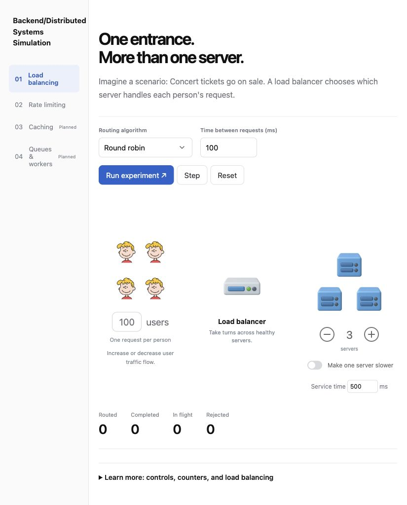
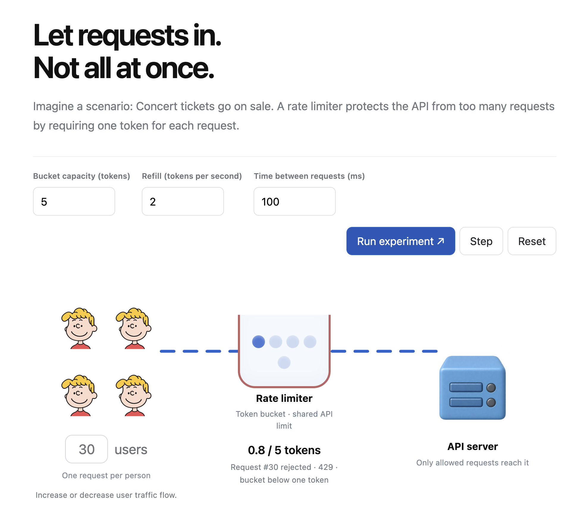

# Distributed systems simulator

I built a Go-backed visual learning website for load balancing and rate limiting. I am preserving it as a learning snapshot and moving on to another project. Caching and queues are unimplemented sidebar placeholders.

## Load balancing



I send one request per person through a load balancer to simulated servers. Round robin takes turns; least connections chooses the server with the fewest active requests. I add or remove servers with minus/plus buttons and make server 1 four times slower to compare algorithms. All servers are healthy in the current UI. The moving branches illustrate routing, not broadcasting: each request goes to one server, identified by its highlight and number in the history table.

## Rate limiting



I use one shared token bucket for the API. Each admitted request consumes one token. Tokens refill with simulated time, up to bucket capacity. Requests with less than one token are rejected with modeled HTTP 429, without queuing or consuming a token. I adjust capacity, refill rate, and arrival spacing. My [rate limiting notes](concepts/ratelimit/README.md) include an example table and burst behavior.

## Run locally

From the repository root:

```sh
go run ./16-distributed-systems-simulator/cmd/server
go test -race ./16-distributed-systems-simulator/...
```

I open http://127.0.0.1:8082/ for load balancing or http://127.0.0.1:8082/rate-limiting.html for rate limiting. No database, Redis, credentials, or cloud setup is required.

Run experiment starts playback. Step stops playback and advances one event. Reset clears results. History appears after the first event. Each experiment starts fresh.

## My understanding

A load balancer is like a receptionist directing people to employees. A rate limiter is like a guard deciding how quickly people may enter. Neither creates server capacity or replaces authentication.

Assigned is total requests sent to a server, active is unfinished requests, and done is completed requests. Assigned = active + done. Requests run concurrently: one starting at 0 ms can finish at 500 ms while another starting at 200 ms finishes at 700 ms. This model has no queue or server capacity limit.

An event is a history entry, not another user. A successful load-balancing request produces routed and completed entries. Rate limiting records one decision per request. 1000 ms is one second; simulated time is separate from playback speed.

## Files and limitations

| Location | Purpose |
| --- | --- |
| `concepts/loadbalancer/` | Routing model and tests |
| `concepts/ratelimit/` | Token-bucket model, tests, and notes |
| `cmd/server/` | Local HTTP server and simulation endpoints |
| `web/index.html`, `web/app.js` | Load-balancing interface |
| `web/rate-limiting.html`, `web/rate-limit.js` | Rate-limiting interface |
| `web/styles.css`, `web/embed.go` | Shared styles and embedded web files |
| `web/assets/`, `docs/screenshots/` | Artwork and UI snapshots |

The browser calls a real Go API, but workers, tokens, response statuses, and timings are simulated. This is not a benchmark or production middleware. No machines are provisioned or tickets purchased. A real multi-instance shared limiter needs coordinated atomic state, for example in Redis.

User cartoons represent individual people up to four, then four representative icons with a total. Device artwork was generated with the built-in image tool from supplied references: a gray rounded device with a blue slot and indicator lights, a blue server box with two slots and lights, and a blond cartoon user with a coral shirt. Backgrounds are transparent; earlier asset variants are retained.

The load-balancing screenshot is a fresh local capture. The rate-limiting screenshot is my supplied October 18, 2026 UI capture.
