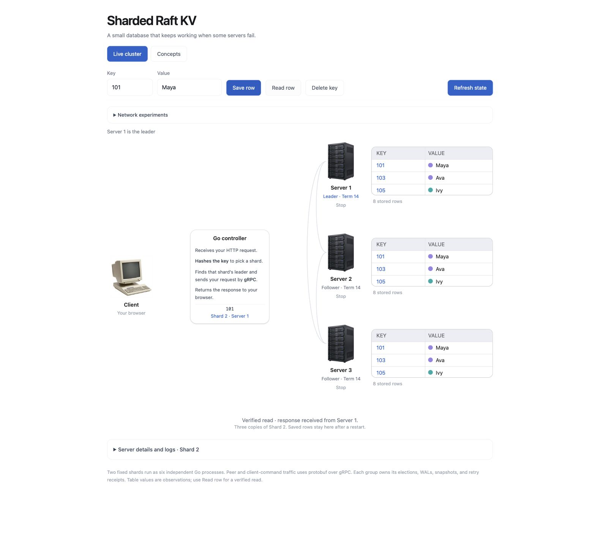
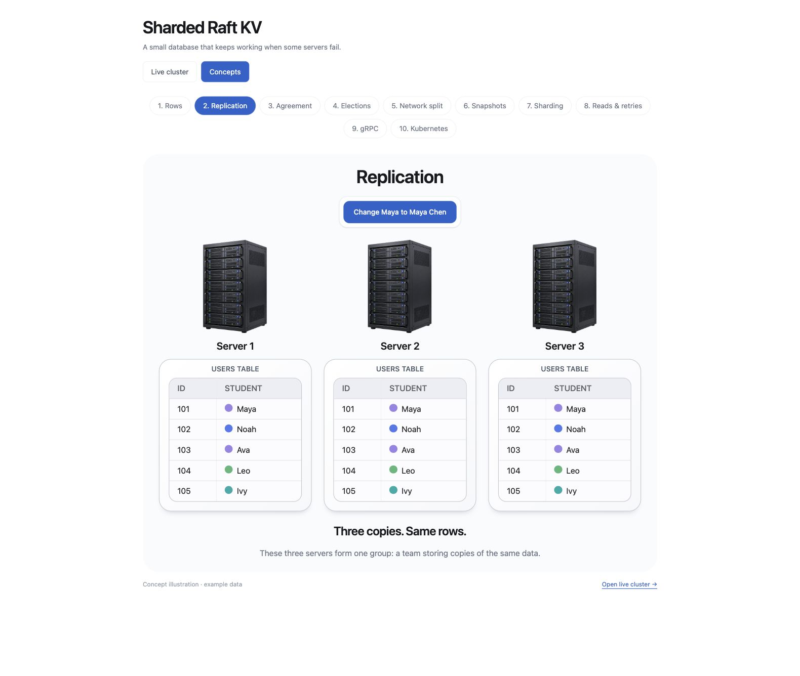
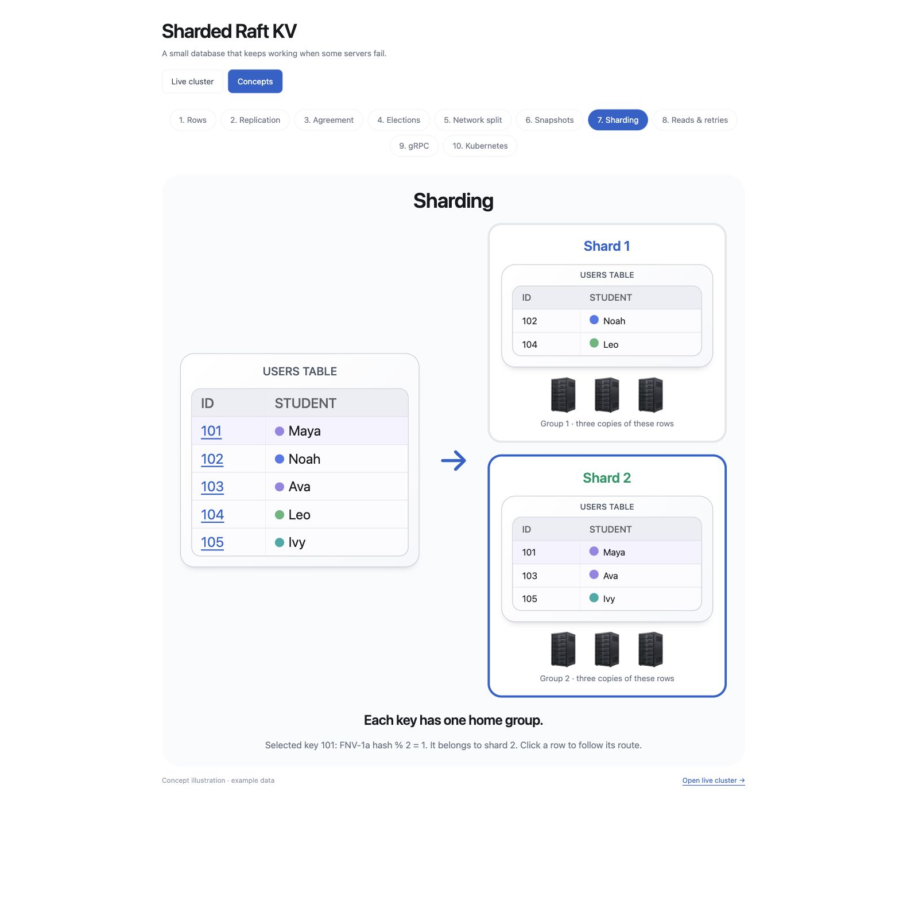
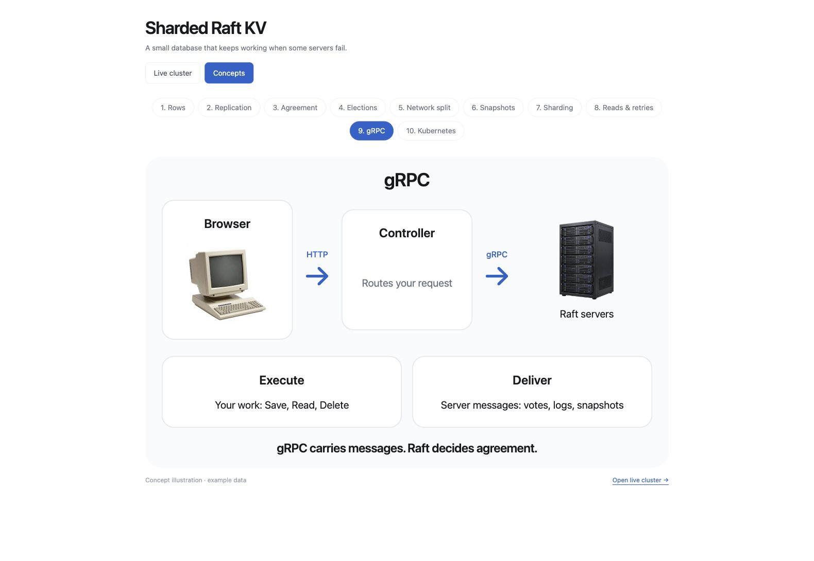
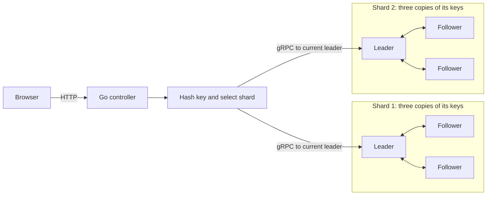
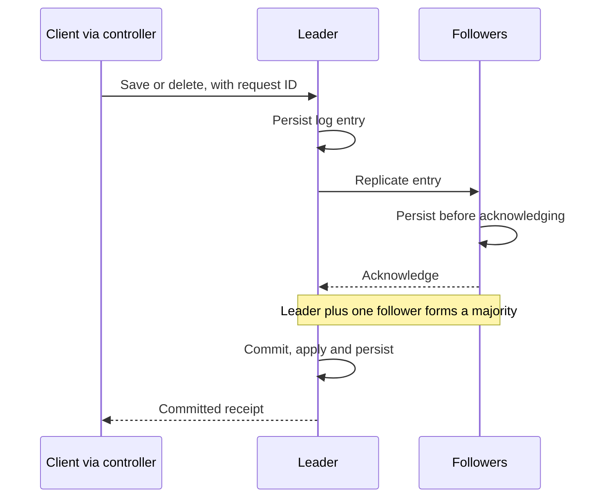

# Sharded Raft KV

A small key-value database that keeps working when some servers fail. Built with Go, Raft, gRPC and a Next.js console.

**The main question:** if the database says “saved,” can we still read that value after failures and recovery?

Saving `101 = Maya` routes the key to one shard. That shard's leader records the instruction and replicates it to followers. The database acknowledges it after Raft commitment, local application and successful persistence. If the leader fails, the remaining majority can elect a replacement.

Sharding divides the data. Replication keeps copies of each division. Raft coordinates those copies.

## Screenshots

**Live cluster.** A verified read of `101 = Maya`, routed to Shard 2's current leader. Each server shows its own applied rows; scroll inside a table to inspect more rows.



<details>
<summary>Concepts: replication, sharding and gRPC</summary>

**Replication:** three servers keep copies of the same rows.



**Sharding:** each key belongs to one group, with three replicas per group.



**gRPC:** the controller routes client commands; servers exchange Raft messages.



</details>

## Architecture

Two fixed shards, three independent Go processes per shard. Each replica owns its WAL, snapshot, applied rows and retry receipts. No PostgreSQL or Redis is required.



Ownership is `FNV-1a-32(UTF-8 key) % 2`. Each shard has its own leader, election terms and quorum. A request cannot fall back to another shard if its owning group is unavailable. The controller routes each submitted key to its owning group.

## Request and recovery rules



- **Writes and deletes:** require Raft commitment. A running server or a delivered message does not establish commitment.
- **Reads:** commit a fresh read barrier before returning the applied value. An isolated former leader cannot successfully return an unverified stale read.
- **Retries:** a timeout means the outcome is unknown. Retry the same operation, key, value and request ID. Committed receipts survive leader changes, snapshots and restarts.
- **Recovery:** each replica reloads its checksummed write-ahead log (WAL). Uncommitted entries remain unapplied until consensus resolves them. Storage faults stop progress rather than report success.
- **Snapshots:** checkpoint committed rows and retry receipts, then compact the old log prefix. A lagging replica can install the checkpoint and catch up.

## Run locally

Requirements: Go 1.25+ and Node.js 22+. Docker is only needed for the optional Kubernetes deployment.

From the repository root, start the backend:

```sh
go run ./17-sharded-raft-kv
```

In a second terminal:

```sh
cd 17-sharded-raft-kv/web
npm ci
npm run dev
```

Open <http://127.0.0.1:8083/>. The controller listens on `8084`; replica ports are `8091–8096`. Saved data stays in `17-sharded-raft-kv/data-sharded/`. Restarting with the same directory preserves it. Use `-data-dir /absolute/new-directory` for a separate database.

For a production frontend build, set `RAFT_API_ORIGIN` to the Go controller address during `npm run build`. The browser still uses same-origin HTTP; Next.js proxies API requests.

## Try the live cluster

1. Save a test row and use **Read row** to verify it.
2. Stop its shard's leader. Wait for a replacement, then read the row again.
3. Restart the old leader and watch it catch up.
4. Isolate the current leader. The connected pair can elect a replacement; the isolated server cannot commit alone. Heal the network afterwards.
5. Stop two replicas in one shard. New writes there cannot commit. The other shard can continue.

Server tables are separately polled observations, not an atomic read of the whole cluster. Use **Read row** for a verified read. Slow request/log playback presents recorded evidence; its timing is not database latency.

## Validation

```sh
go test -race ./17-sharded-raft-kv/...

cd 17-sharded-raft-kv/web
npm run typecheck
RAFT_API_ORIGIN=http://127.0.0.1:8084 npm run build
```

Tests cover elections, quorum loss, gRPC transport, wrong-shard rejection, process crashes, WAL recovery, snapshots and retry deduplication. Porcupine checks bounded concurrent histories against a sequential key-value and request-ID model. These checks are evidence for the tested cases, not a proof of every execution.

## Code map

| Area | Files |
| --- | --- |
| Consensus, commitment and application | `cluster.go`, `client.go` |
| WAL, recovery and log compaction | `storage.go`, `snapshot.go` |
| Replica processes and key routing | `network.go`, `sharding.go` |
| Typed RPC messages and transport | `api/raftv1/raft.proto`, `grpc_transport.go` |
| Kubernetes identity and configuration | `deployment.go`, `deploy/kubernetes/` |
| Live console and observed-message playback | `web/src/components/`, `web/src/lib/` |

The optional [Kubernetes deployment guide](deploy/kubernetes/README.md) covers StatefulSets, persistent volumes and Pod replacement. Kubernetes replaces processes; Raft still decides leadership and commitment.

## Limits

Fixed membership and shard ownership; no shard movement or cross-shard transactions. Snapshot creation is manual. Retry receipts are not evicted. Reads append barriers, WAL revisions store full state, and replication transfers full retained logs, which limit performance. Election timeouts are staggered and deterministic.

Local replicas share one machine's failure risk. Sync relies on the filesystem and device honouring it. This does not establish 99.99% availability or physical power-loss safety. The lab uses unauthenticated administrative APIs and cleartext RPCs on trusted local networks.

References: [Raft paper](https://raft.github.io/raft.pdf), [Porcupine](https://github.com/anishathalye/porcupine).
